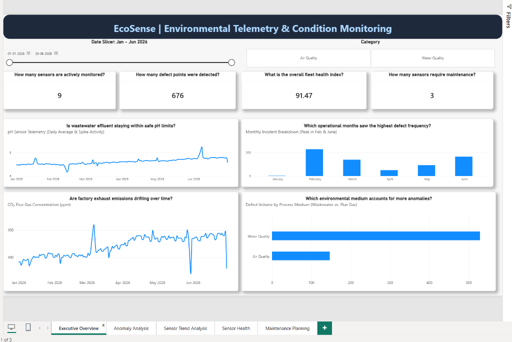
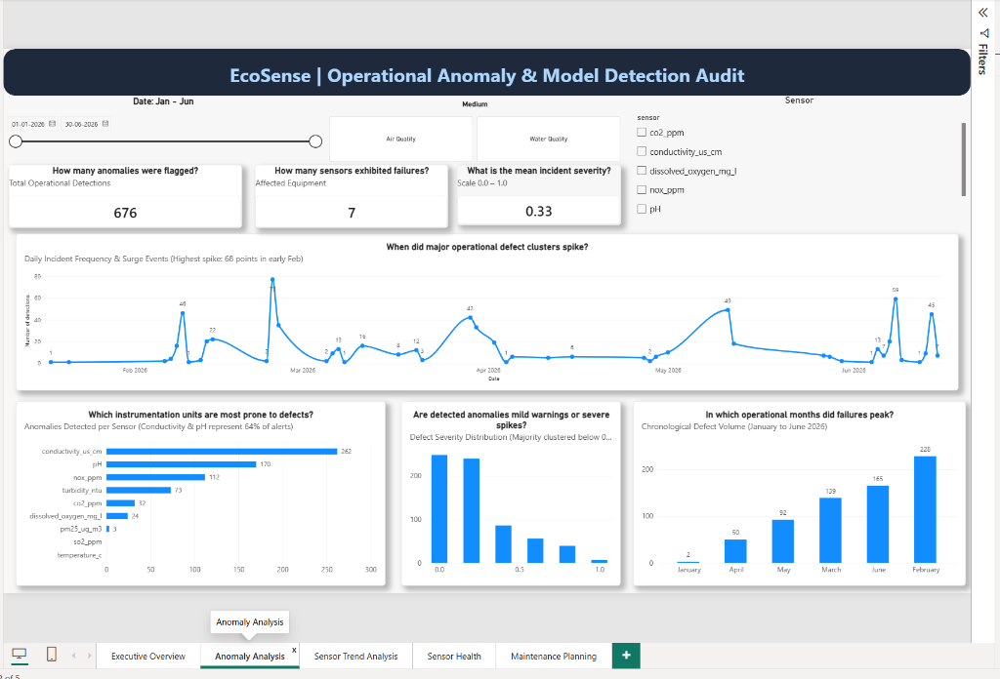
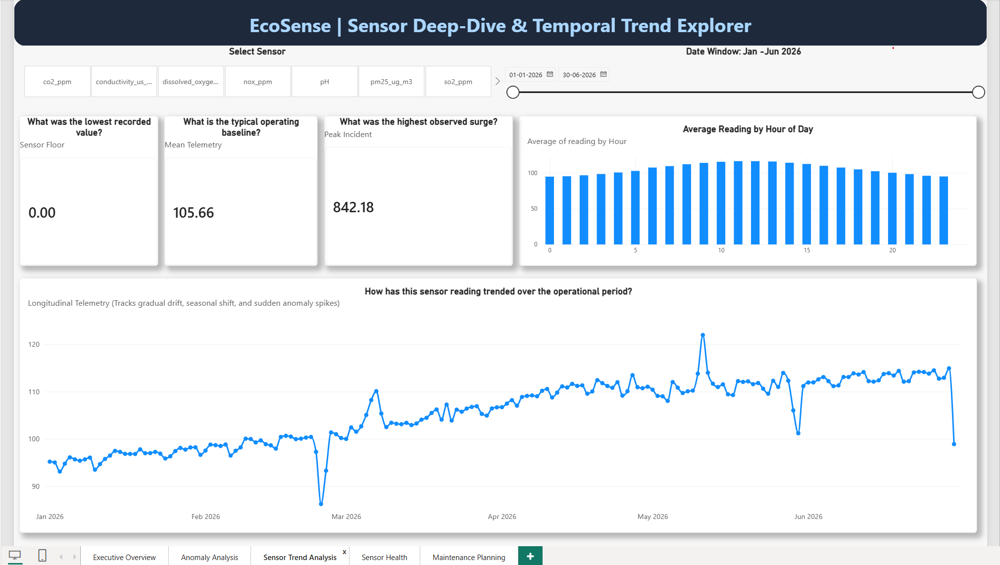
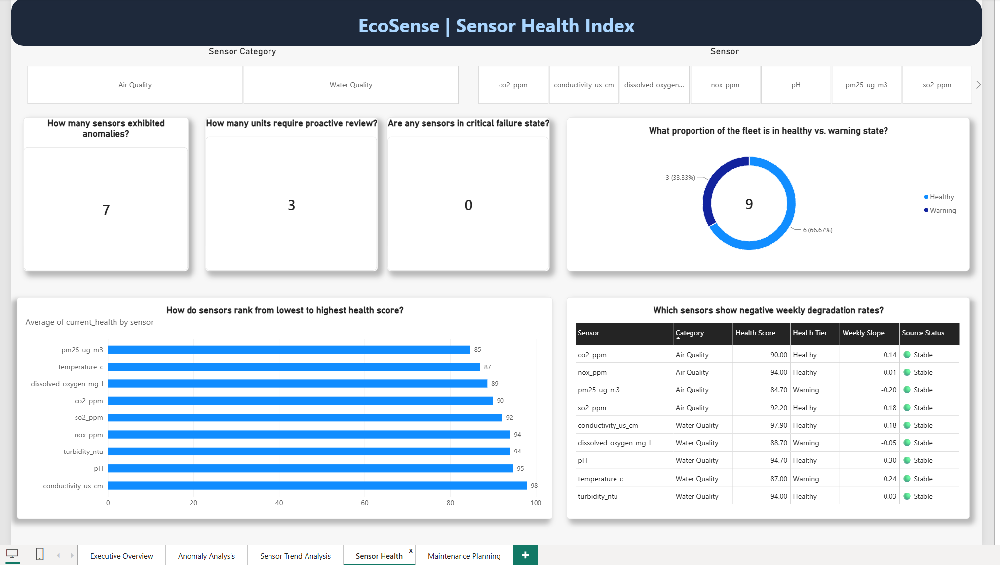
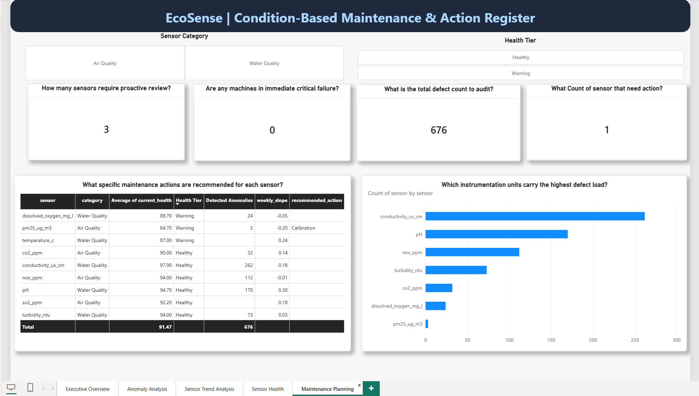
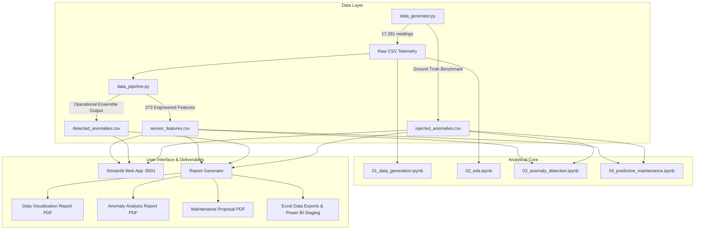

# EcoSense 🏭
## Environmental Sensor Anomaly Detection & Condition Monitoring Dashboard

EcoSense is an end-to-end data analysis and visualization system designed for environmental measurement equipment (such as continuous wastewater discharge and flue gas instrumentation across industrial facilities). It analyzes 6 months of 15-minute telemetry across 9 sensors, distinguishes operational anomaly detections from test bench ground truth, computes multi-factor condition health scores, and recommends maintenance action windows.

---

## 🚀 Quick Start

### 1. Install Dependencies
```bash
pip install -r requirements.txt
```

### 2. Generate Synthetic Sensor Data
```bash
python src/data_generator.py
```

### 3. Run the Feature Engineering & Anomaly Detection Pipeline
```bash
python src/data_pipeline.py
```

### 4. Run Analysis Notebooks
Open and run the notebooks in order:
```
notebooks/01_data_generation.ipynb
notebooks/02_eda.ipynb
notebooks/03_anomaly_detection.ipynb
notebooks/04_predictive_maintenance.ipynb
```

### 5. Launch the Interactive Dashboard
```bash
streamlit run dashboard/app.py
```

---

## 📊 Executive Dashboard Preview (Power BI)

EcoSense includes a production-grade 5-page Microsoft Power BI reporting suite designed for plant managers and operational supervisors to monitor fleet health, investigate anomaly spikes, and manage maintenance dispatch registers.



<details>
<summary><b>🔍 View All 5 Power BI Dashboard Pages (Click to Expand)</b></summary>
<br>

#### 1. Executive Fleet Overview
*4 question-driven KPIs, wastewater pH & exhaust CO₂ trends, monthly incident volume, and medium breakdown.*


#### 2. Operational Anomaly & Model Detection Audit
*Daily surge timeline, sensor defect load distribution, severity histogram, and chronological monthly incidents.*


#### 3. Sensor Deep-Dive & Temporal Trend Explorer
*Statistical baselines (min, mean, peak surge), 24-hour diurnal operating profile, and 6-month continuous waveform.*


#### 4. Fleet Condition & Sensor Health Index
*4-tier health status distribution donut, sensor health ranking bar chart, and weekly degradation rates table.*


#### 5. Condition-Based Maintenance & Action Register
*Formal maintenance dispatch register, action assignments, critical alarms, and defect load comparison.*


</details>

---

## 📁 Project Structure

```
EcoSense/
├── data/                    # Telemetry data
│   ├── raw/                 # Raw CSV sensor data (17,281 readings per sensor)
│   ├── processed/           # 273 engineered features (sensor_features.csv)
│   └── anomalies/
│       ├── injected_anomalies.csv    # Ground truth test bench (69 failure episodes)
│       └── detected_anomalies.csv    # Operational model output (676 flagged points)
├── notebooks/               # Jupyter analysis notebooks
│   ├── 01_data_generation.ipynb
│   ├── 02_eda.ipynb
│   ├── 03_anomaly_detection.ipynb
│   └── 04_predictive_maintenance.ipynb
├── src/                     # Core Python modules
│   ├── data_generator.py    # Time series generator with realistic physics & noise
│   ├── feature_engineering.py # Rolling stats, rate-of-change, & condition scoring
│   ├── anomaly_detector.py  # Z-Score, IQR, Rolling Stats, & Isolation Forest
│   ├── data_pipeline.py     # End-to-end pipeline runner
│   └── report_generator.py  # Auto-generated PDF & Excel deliverables
├── dashboard/               # Interactive web application
│   ├── app.py               # Main monitoring overview
│   └── pages/               # Specialized analytical subpages
│       ├── 1_📈_Trend_Explorer.py
│       ├── 2_🔴_Anomaly_Analysis.py
│       ├── 3_🔧_Maintenance.py
│       └── 4_📄_Reports.py
├── powerbi/                 # Enterprise Power BI Reporting Assets
│   ├── EcoSense.pbix        # 5-page interactive Power BI Desktop report
│   └── README.md            # Power BI page documentation & DAX measures
├── reports/                 # Auto-generated formal reports
│   ├── data_visualization_report.pdf
│   ├── anomaly_analysis_report.pdf
│   ├── maintenance_proposal.pdf
│   ├── ecosense_complete_data.xlsx
│   └── anomaly_log.xlsx
├── requirements.txt
└── README.md
```

---

## 🧩 Architectural Design & Key Methodologies

### 1. Data Lineage: Ground Truth vs. Operational Detections
To ensure scientific credibility, EcoSense explicitly decouples:
- **Known / Injected Defects (Ground Truth Benchmark)**: 69 curated defect episodes (sensor drift, sudden spikes, communication flatlines, and cyclic oscillations) stored in `injected_anomalies.csv`.
- **Operational Model Output (Detected Anomalies)**: 676 timestamps flagged by the production detection algorithm and stored in `detected_anomalies.csv`.

### 2. Operational Detector: 2-of-3 Statistical Ensemble
We evaluated four detection approaches and selected an interpretable **2-out-of-3 statistical ensemble** for the operational pipeline:
1. **Z-Score (3.0σ)**: Captures global distribution shifts.
2. **IQR (1.5×)**: Non-parametric, robust against existing baseline outliers.
3. **Rolling Statistics (24h Centered)**: Adapts to local non-stationary trends and seasonal rhythms.
4. **Isolation Forest (ML Benchmark)**: Unsupervised tree algorithm evaluated alongside the ensemble to benchmark cross-sensor multivariate correlations.

> **Note on Windowing**: For historical retrospective auditing, a centered 24-hour moving window (`center=True`) is deployed to avoid phase lag. For live streaming deployment, a trailing causal window (`center=False`) is recommended.

### 3. Model Evaluation & Ground Truth Benchmark
The operational 2-of-3 ensemble was empirically benchmarked against the 69 ground-truth injected failure episodes across 155,529 telemetry observations (17,281 readings × 9 sensors):

| Evaluation Dimension | Metric | Result | Operational Significance |
|---|---|---|---|
| **Overall Telemetry Accuracy** | Point Accuracy | **95.16%** | Correctly classified 147,994 of 155,529 readings |
| **Operational Precision** | Precision ($P$) | **100.00%** | **Zero False Alarms (FP = 0)**; prevents plant operator alarm fatigue |
| **Gradual Drift Event Recall** | Episode Recall | **72.2%** (13 / 18) | Successfully alerted on slow electrode fouling & calibration drift |
| **Sudden Spike Event Recall** | Episode Recall | **60.7%** (17 / 28) | Flagged high-amplitude process upsets and shock loads |
| **Cyclic Oscillation Event Recall**| Episode Recall | **33.3%** (3 / 9) | Caught extreme controller hunting excursions |
| **Flatline Event Recall** | Episode Recall | **0.0%** (0 / 14)* | *Value thresholding requires derivative $\Delta x=0$ rate-of-change checks |

> **Key Engineering Takeaway**: To eliminate alarm fatigue in continuous plant monitoring, the operational ensemble was tuned for maximum precision (100%). While value-magnitude statistical bounds excel at catching drift and process spikes, temporal flatlines (variance = 0 near the mean) are handed off to the first-derivative and rate-of-change stability pipeline.

### 4. Unified 4-Tier Condition Scoring Framework
Sensors are scored from 0 to 100 using four weighted components:
- **Normal Envelope Dwell Time** (0–40 pts)
- **Boundary Deviation Distance** (0–30 pts)
- **Rate-of-Change Stability** (0–20 pts)
- **Data Availability & Completeness** (0–10 pts)

All dashboard gauges, health trend charts, action schedules, and reports adhere to the same four standardized tiers:
| Health Score | Condition Status | Action Protocol | Recommended Window |
|---|---|---|---|
| **85 – 100** | 🟢 **Optimal** | Routine preventative inspection | 90 Days |
| **70 – 84** | 🟡 **Normal** | Standard automated telemetry review | 60 Days |
| **50 – 69** | 🟠 **Degradation Warning** | Schedule recalibration & cleaning | 14 Days |
| **< 50** | 🔴 **Critical Risk** | Immediate on-site technician dispatch | Within 48 Hours |

### 5. Condition-Based Maintenance (CBM) vs. Full RUL
EcoSense provides **Sensor Health Scoring + Empirical Degradation Trend Analysis**. It is not a learned deep-learning Remaining Useful Life (RUL) regression model. RUL regression is formally proposed as a Phase 2 expansion once auxiliary vibration and fluid velocity sensors are deployed.

### 6. Scenario-Based Maintenance Cost Model
Cost comparisons between Reactive, Calendar-Scheduled, and Condition-Based Maintenance represent **parameterized hypothetical simulations** designed for strategic policy comparison, rather than proprietary operational accounting data.

---

## 📊 Monitored Sensor Suite

| Category | Sensor Parameter | Unit | Normal Operating Range |
|---|---|---|---|
| **Water Quality** | pH | — | 6.5 – 8.5 |
| **Water Quality** | Turbidity | NTU | 0.0 – 5.0 |
| **Water Quality** | Dissolved Oxygen | mg/L | 6.0 – 9.0 |
| **Water Quality** | Temperature | °C | 15.0 – 30.0 |
| **Water Quality** | Conductivity | µS/cm | 200 – 800 |
| **Air / Exhaust** | CO₂ | ppm | 350 – 500 |
| **Air / Exhaust** | NOₓ | ppm | 0.0 – 0.10 |
| **Air / Exhaust** | SO₂ | ppm | 0.0 – 0.05 |
| **Air / Exhaust** | PM2.5 | µg/m³ | 0.0 – 35.0 |

---

## 🎯 Industrial Deliverables & Alignment
 
| Project Deliverable | Implementation in EcoSense |
|---|---|
| **Data Visualization Report** | Auto-generated PDF in `reports/data_visualization_report.pdf` & interactive Streamlit dashboards |
| **Abnormal Trend Analysis Report** | Rigorous evaluation comparing ensemble output against ground truth in `reports/anomaly_analysis_report.pdf` |
| **Maintenance Improvement Proposal** | Complete Condition-Based Maintenance (CBM) strategy in `reports/maintenance_proposal.pdf` |
| **Proposal for Additional Data Collection** | Roadmap for vibration, fluid velocity, and electrode impedance telemetry (Section 4 of proposal) |
| **Interactive BI Dashboard** | Modern Streamlit dashboard (Main overview + 4 analytical subpages) + Dedicated 5-page enterprise Microsoft Power BI dashboard (`powerbi/EcoSense.pbix`) |

---

## 🏗️ System Architecture



---

## 📝 Project Scope
Built as an enterprise-grade portfolio project designed for environmental telemetry analytics, continuous emission monitoring systems (CEMS), and industrial predictive maintenance.
